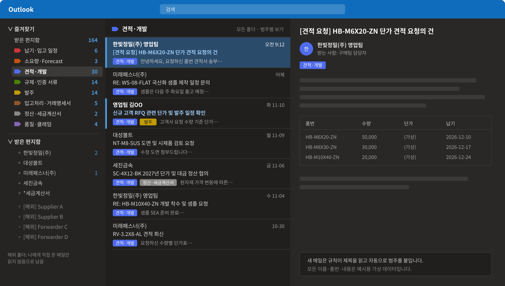
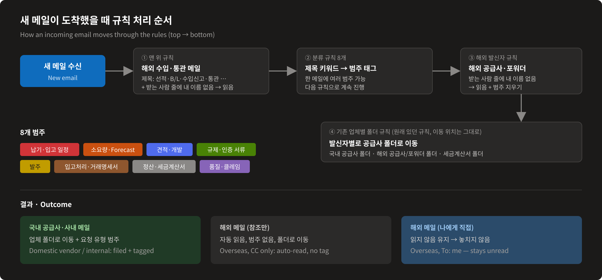
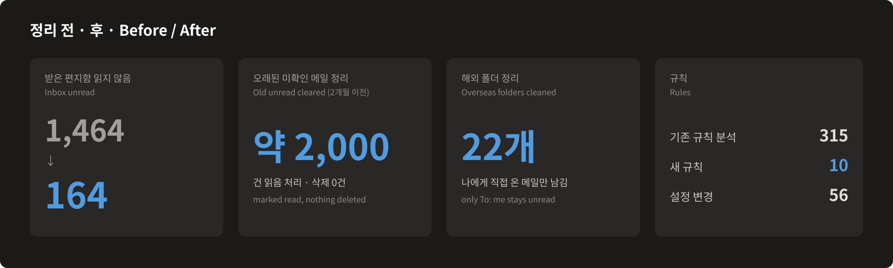

[한국어](README.md) | **English**

# Purchasing Mailbox Auto-Triage

A project that reorganized a purchasing buyer's Outlook mailbox so that **emails are automatically grouped by request type, and overseas emails the buyer no longer handles are automatically marked as read.** The buyer defined the business problem and designed the categories and rules; the implementation was done in Outlook on the web together with an AI assistant (Claude).



> All vendors, part numbers, names and content shown are fictional sample data. No real company, supplier or personal information is included.

## Why I built it

The mailbox was organized only by supplier folders, and many types of requests arrived mixed together every day. After a change in responsibilities about five months earlier, I handled domestic purchasing only, but overseas supplier and forwarder emails kept arriving.

| Problem | Impact |
|---|---|
| Delivery date (ETA) questions, new quotations/development, and regulatory document requests such as COO were all mixed in one inbox | Finding a specific request meant opening emails one by one |
| Subject lines varied, so checking whether a request was a repeat meant opening attachments | Duplicate responses and slow checks |
| 1,464 unread emails in the inbox | Important new emails got buried |
| Emails from overseas suppliers and forwarders I no longer handle kept piling up in 22 folders | Unread counts became meaningless |
| Some overseas emails were still addressed directly to me | Whole folders couldn't simply be ignored |

→ I chose to **keep the existing supplier-folder structure** and add **request-type categories (tags)** on top of it. Emails stay in their folders, and clicking a category shows every email of that type across all folders.

## Key features

- **Automatic categorization by request type**: when a new email arrives, rules read keywords in the subject and apply one of 8 categories.
  - One email can have several categories (e.g. "ETA inquiry for PO items" → PO + Delivery schedule).
  - Categories are pinned to Favorites, so one click shows that request type across all folders.
- **Overseas emails auto-marked as read**: emails from overseas suppliers and forwarders, and internal import/customs emails, are marked as read automatically.
  - Exception: **emails with my name on the To line stay unread.** Emails where I'm only on CC are marked as read.
- **Cleanup of existing mail**: about 2,000 unread emails older than two months were marked as read, and the last two months of mail were categorized.
- **Nothing deleted or moved**: no step deleted emails or moved them to other folders. Existing personal categories were kept as they were.

## Screens

| Rule processing order | Before / after |
|---|---|
|  |  |

## Core rules (summary)

| Category (Korean label) | Subject keywords |
|---|---|
| Delivery schedule (납기·입고 일정) | 입고 일정, 입고 계획, 입고예정, 납기, 납품 일정, 분할공급, 결품 |
| Demand / Forecast (소요량·Forecast) | 소요량, Fcst, forecast, 수요, 예상 수량 |
| Quotation & development (견적·개발) | 견적, quotation, 단가, 개발, 국산화, 샘플, 도면, 시제품 |
| Regulatory documents (규제·인증 서류) | COO, C/O, 원산지, MSDS, RoHS, REACH, 성적서, 분쟁광물, CMRT, 인증 |
| Purchase orders (발주) | 발주서, 발주, PO No, PO#, Purchase Order, Order no |
| Goods receipt & delivery notes (입고처리·거래명세서) | 입고처리, 거래명세서 |
| Settlement & tax invoices (정산·세금계산서) | 세금계산서, 정산, 대금 |
| Quality & claims (품질·클레임) | 품질, 불량, 부적합, warranty, claim |

| Rule | Logic |
|---|---|
| Overseas import/customs mail | Subject contains shipment, HAWB, B/L, waybill, import declaration or customs terms + my name not on the To line → mark as read |
| Overseas senders | Sender is an overseas supplier or forwarder + my name not on the To line → mark as read, clear categories |
| Rule order | Category rules run before the existing folder rules, with "stop processing more rules" turned off |

Design reasons and lessons learned are in the [rule design document](docs/rule-design.en.md).

## Results

| Item | Before | After |
|---|---|---|
| Unread emails in inbox | 1,464 | 164 |
| Old unread emails | about 2,000 | 0 (marked read, 0 deleted) |
| Overseas folders | Unread mail piling up in 22 folders | Only emails addressed to me remain unread |
| Rules | 315 (all folder moves) | 10 new rules, 56 existing rules adjusted |

## Tools used

- **Built-in Outlook on the web features only**: Rules, Categories, Favorites, Search. No software or add-ins were installed on the work PC.
- **Claude + Chrome extension**: the company blocked direct mailbox connectors, so the AI operated the Outlook page that I had signed into in my own browser.
  - Read and analyzed all 315 existing rules by supplier and folder
  - Created categories and rules, and processed existing mail in bulk
  - Hard-to-reverse changes were done only after I approved the plan for each step
- **Division of work**: I defined the problem, the classification criteria, the categories and keywords, and the exception logic (To vs CC). The AI carried out the clicks and bulk processing.

## Try it yourself

The same structure can be built in Outlook on the web.

1. **Settings → Accounts → Categories**: create the 8 categories and add them to Favorites.
2. **Settings → Mail → Rules → Add new rule**
   - Condition: `Subject includes` → enter keywords
   - Action: `Categorize` → choose the category
   - **Uncheck "Stop processing more rules"**
3. For overseas mail, use two conditions: `Sender address includes` (domains/addresses) + `I'm not on the To line`, with the action `Mark as read`.
4. In the rule list, make sure the new rules sit **above** the existing folder-move rules.
5. To apply a rule to existing inbox mail, edit it, tick **"Run rule now"**, and save.

## Folder structure

```
README.md              Korean description
README.en.md           English description
docs/rule-design.md    Rule design document (Korean)
docs/rule-design.en.md Rule design document (English)
docs/images/           Screen examples (fictional data, SVG sources included)
```

## How it was built

1. **Current-state analysis**: reviewed the inbox, folder structure and all 315 existing rules in read-only mode.
2. **Planning**: defined categories and keywords based on the request types I actually receive. Internal emails were included; overseas emails I no longer handle were excluded from categorization.
3. **Step-by-step rollout**: old mail marked read → overseas folders cleaned → rules and categories created → existing mail categorized, checking the results after each step.
4. **Refinement in daily use**: after a week of use, adjusting keywords based on the subjects of emails that were mis-tagged or missed.
