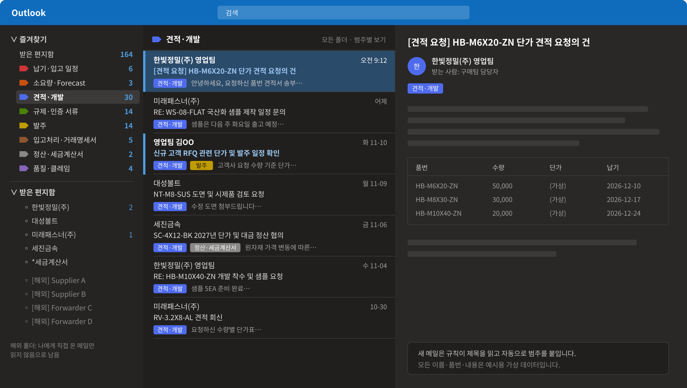
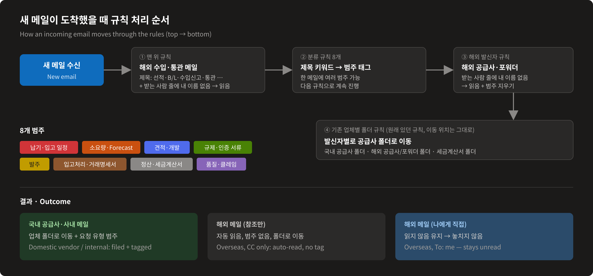
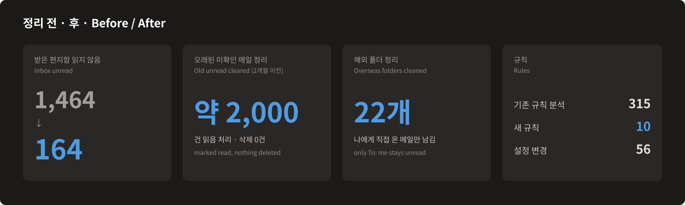

**한국어** | [English](README.en.md)

# 구매 메일함 자동 분류

구매 담당자의 Outlook 메일함에서 **요청 유형별로 메일을 자동 분류하고, 담당하지 않는 해외 메일은 자동으로 읽음 처리**하도록 정리한 프로젝트입니다. 구매 담당자가 직접 업무 문제를 정의하고 분류 기준과 규칙을 설계했으며, AI 도구(Claude)와 함께 Outlook 웹에서 구현했습니다.



> 화면의 공급사·품번·이름·내용은 모두 예시용 가상 데이터입니다. 실제 회사·거래처·개인 정보는 포함하지 않았습니다.

## 왜 만들었나

메일함은 공급사별 폴더로만 나뉘어 있었고, 하루에도 여러 종류의 요청이 섞여 들어왔습니다. 약 5개월 전 업무 분장(R&R) 변경으로 국내 구매만 담당하게 되었지만, 해외 공급사·포워더 메일은 계속 받고 있었습니다.

| 문제 | 영향 |
|---|---|
| 납기 문의, 신규 견적·개발, 원산지(COO) 등 규제 서류 요청이 한 메일함에 섞여 있음 | 원하는 요청을 찾으려면 메일을 하나씩 열어봐야 함 |
| 제목이 제각각이라 같은 요청인지 첨부파일까지 열어 비교해야 함 | 같은 요청에 중복 대응하거나 확인 시간이 오래 걸림 |
| 받은 편지함 읽지 않은 메일 1,464건 | 새로 온 중요한 메일이 묻힘 |
| 더 이상 담당하지 않는 해외 공급사·포워더 메일이 22개 폴더에 계속 쌓임 | 읽지 않은 숫자가 의미가 없어짐 |
| 해외 메일 중에도 나에게 직접 온 메일은 놓치면 안 됨 | 폴더 전체를 무시할 수도 없음 |

→ 기존에 쓰던 **공급사별 폴더 구조는 그대로 두고**, 그 위에 **요청 유형별 범주(태그)** 를 덧붙이는 방식을 선택했습니다. 메일은 원래 폴더에 있고, 범주를 누르면 모든 폴더에서 같은 유형의 요청만 모아 볼 수 있습니다.

## 주요 기능

- **요청 유형별 자동 분류**: 새 메일이 오면 규칙이 제목의 키워드를 읽고 8개 범주 중 맞는 것을 붙입니다.
  - 한 메일에 여러 범주가 붙을 수 있습니다. (예: "발주 제품 입고 일정 문의" → 발주 + 납기·입고 일정)
  - 범주는 즐겨찾기에 고정해 한 번 클릭으로 모든 폴더의 같은 유형 메일을 볼 수 있습니다.
- **해외 메일 자동 읽음**: 해외 공급사·포워더 메일과 사내의 수입·통관 메일은 자동으로 읽음 처리합니다.
  - 단, **받는 사람(To) 줄에 내 이름이 있는 메일은 읽지 않음으로 남깁니다.** 참조(CC)만 된 메일은 읽음 처리합니다.
- **기존 메일 정리**: 2개월 이전의 읽지 않은 메일(약 2,000건)은 읽음 처리하고, 최근 2개월 메일에도 범주를 붙였습니다.
- **삭제·이동 없음**: 모든 단계에서 메일을 지우거나 다른 폴더로 옮기지 않았습니다. 기존에 쓰던 범주(태그)도 그대로 유지했습니다.

## 화면

| 규칙 처리 순서 | 정리 전·후 |
|---|---|
|  |  |

## 핵심 규칙 (요약)

| 범주 | 제목 키워드 |
|---|---|
| 납기·입고 일정 | 입고 일정, 입고 계획, 입고예정, 납기, 납품 일정, 분할공급, 결품 |
| 소요량·Forecast | 소요량, Fcst, forecast, 수요, 예상 수량 |
| 견적·개발 | 견적, quotation, 단가, 개발, 국산화, 샘플, 도면, 시제품 |
| 규제·인증 서류 | COO, C/O, 원산지, MSDS, RoHS, REACH, 성적서, 분쟁광물, CMRT, 인증 |
| 발주 | 발주서, 발주, PO No, PO#, Purchase Order, Order no |
| 입고처리·거래명세서 | 입고처리, 거래명세서 |
| 정산·세금계산서 | 세금계산서, 정산, 대금 |
| 품질·클레임 | 품질, 불량, 부적합, warranty, claim |

| 규칙 | 내용 |
|---|---|
| 해외 수입·통관 메일 | 제목에 선적·HAWB·B/L·waybill·수입신고·통관 + 받는 사람 줄에 내 이름 없음 → 읽음 |
| 해외 발신자 | 해외 공급사·포워더 발신자 + 받는 사람 줄에 내 이름 없음 → 읽음, 범주 지우기 |
| 규칙 순서 | 분류 규칙은 "더 이상 규칙 처리 중지"를 끄고 기존 폴더 이동 규칙보다 먼저 실행 |

자세한 설계 이유와 시행착오는 [규칙 설계서](docs/rule-design.md)에 있습니다.

## 결과

| 항목 | 전 | 후 |
|---|---|---|
| 받은 편지함 읽지 않음 | 1,464건 | 164건 |
| 오래된 미확인 메일 | 약 2,000건 | 0건 (읽음 처리, 삭제 0건) |
| 해외 폴더 | 22개 폴더에 미확인 메일 누적 | 나에게 직접 온 메일만 남음 |
| 규칙 | 315개 (모두 폴더 이동) | 새 규칙 10개 추가, 기존 규칙 56개 설정 변경 |

## 사용한 도구

- **Outlook 웹의 기본 기능만 사용**: 규칙(Rules), 범주(Categories), 즐겨찾기, 검색. 회사 PC에 별도 프로그램이나 추가 기능을 설치하지 않았습니다.
- **Claude + Chrome 확장 프로그램**: 회사 정책상 메일 연동(커넥터)이 막혀 있어, 브라우저에서 직접 로그인한 Outlook 화면을 AI가 조작하는 방식으로 진행했습니다.
  - 기존 규칙 315개를 읽어 업체·폴더별로 분석
  - 범주·규칙 생성, 기존 메일 일괄 처리
  - 되돌리기 어려운 변경은 매 단계 계획을 확인받은 뒤 진행
- **역할 분담**: 문제 정의, 분류 기준, 범주와 키워드, 예외 조건(To vs CC)은 직접 정했고, 실제 클릭 작업과 대량 처리는 AI가 수행했습니다.

## 직접 적용해 보기

Outlook 웹에서 같은 구조를 만들 수 있습니다.

1. **설정 → 계정 → 범주**에서 범주 8개를 만들고 즐겨찾기에 추가합니다.
2. **설정 → 메일 → 규칙 → 규칙 추가**
   - 조건: `제목에 포함` → 키워드 입력
   - 작업: `분류` → 범주 선택
   - **"더 이상 규칙 수행 중지"는 체크 해제**
3. 해외 메일 규칙은 조건을 두 개 겁니다: `보낸 사람 주소에 포함`(도메인·주소) + `받는 사람 줄에 내 이름이 없는 경우`, 작업은 `읽은 상태로 표시`.
4. 규칙 목록에서 새 규칙들이 기존 폴더 이동 규칙보다 **위에** 있는지 확인합니다.
5. 기존 받은 편지함 메일에 적용하려면 규칙 편집에서 **"지금 규칙 실행"** 을 체크하고 저장합니다.

## 폴더 구조

```
README.md              한국어 설명
README.en.md           영어 설명
docs/rule-design.md    규칙 설계서 (설계 이유, 시행착오)
docs/rule-design.en.md 규칙 설계서 (영어)
docs/images/           화면 예시 (가상 데이터, SVG 원본 포함)
```

## 만든 과정

1. **현황 분석**: 받은 편지함과 폴더 구조, 기존 규칙 315개를 읽기 전용으로 확인했습니다.
2. **기획**: 실제 받는 요청 유형을 바탕으로 범주와 키워드를 정했습니다. 사내 메일도 포함하고, 담당이 아닌 해외 메일은 분류 대상에서 뺐습니다.
3. **단계별 적용**: 오래된 메일 읽음 처리 → 해외 폴더 정리 → 규칙·범주 생성 → 기존 메일 분류 순서로, 단계마다 결과를 확인했습니다.
4. **실사용 후 보완**: 일주일간 사용하면서 잘못 분류되거나 빠지는 메일의 제목을 보고 키워드를 조정합니다.
